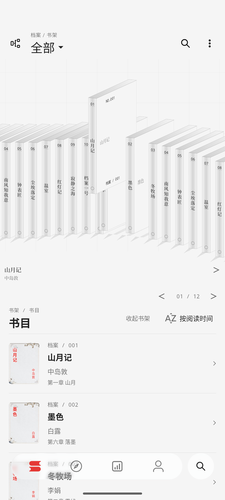
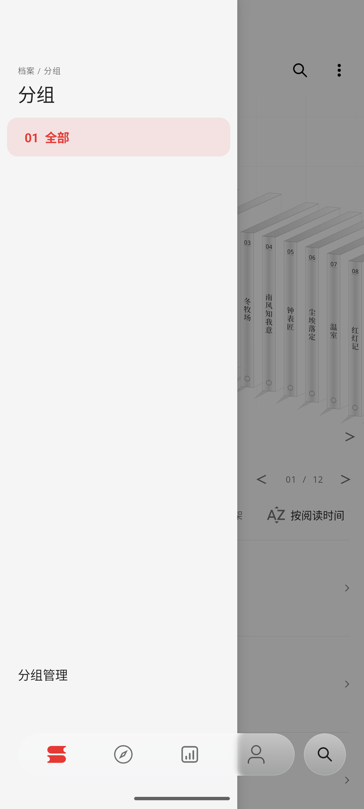
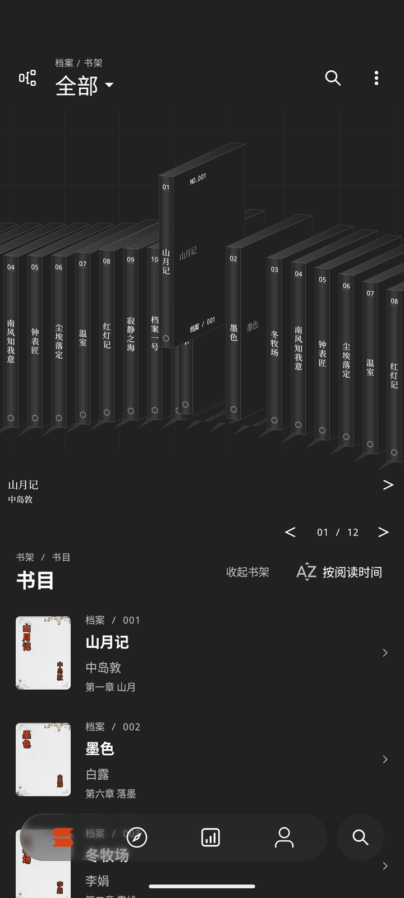
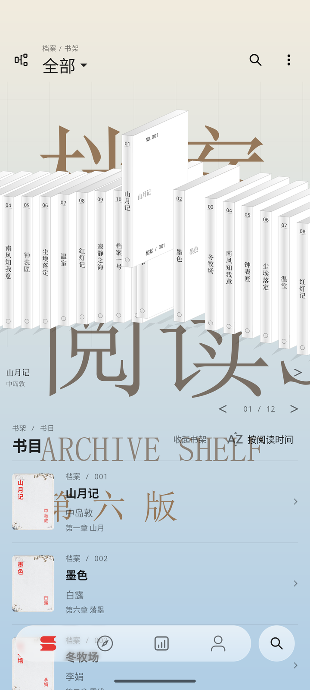
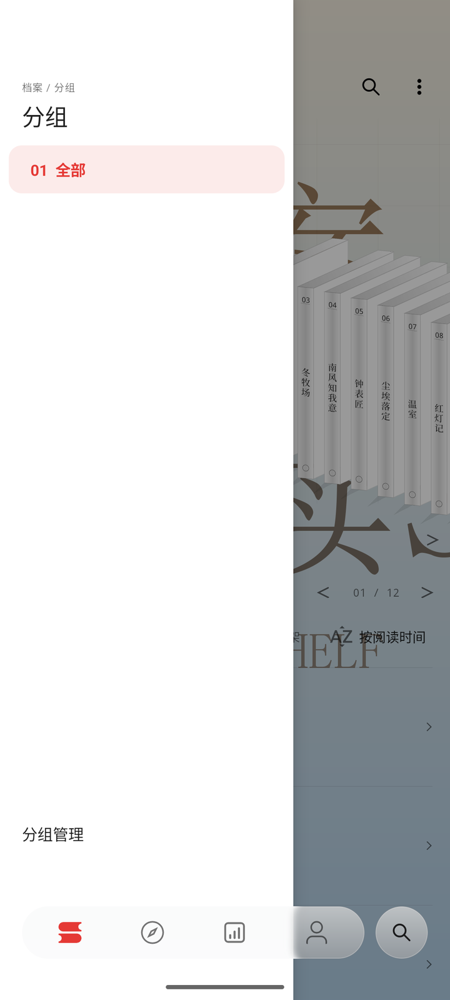
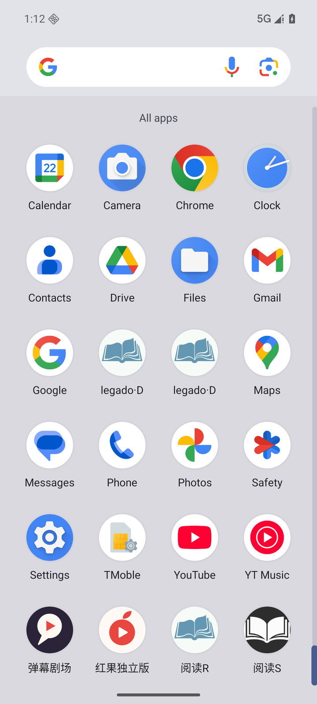
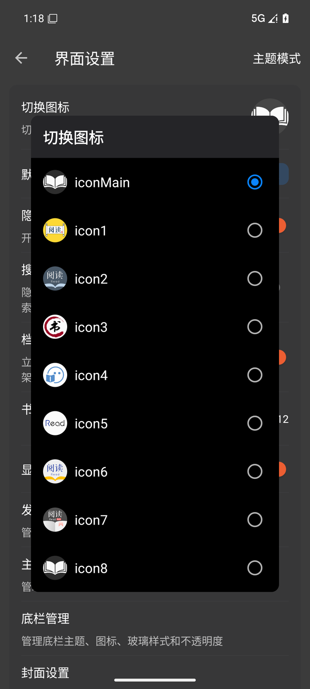

  
  <h1>阅读S · 档案式书架</h1>
  
给「阅读R」加了一页<b>档案式书架</b>：3D 立体书架 + 档案式书目 + 分组抽屉

  

    <a href="https://github.com/sssdex/legado/releases/latest"><b>⬇ 下载 APK</b></a>
    &nbsp;·&nbsp;
    <a href="ARCHIVE-SHELF.md">改动与构建说明</a>
    &nbsp;·&nbsp;
    <a href="README-UPSTREAM.md">上游原版说明</a>
  

  包名 <code>com.legado.archive</code> · 与官方阅读R 共存 · 默认简体中文 · 桌面名「阅读S」
   
  书架设计来自 <a href="https://github.com/P5UEDGK/Wenku8_Flutter">Wenku8_Flutter</a>，几何移植自 <a href="https://github.com/AzukiPann/AzukiReader">AzukiReader</a> · 详见 <a href="#致谢">致谢</a>

 

 

## 我加的东西

书架页重做成「档案」：上面一排立体的书，下面一份档案式书目，分组收进左侧抽屉。设置里留了开关，关掉就是原来的书架。

| 新增 | 说明 |
| --- | --- |
| **立体书架** | 平行投影（不是 3D 透视）：书脊挨着书脊，当前这本被「抽出」上浮、封面朝右上铺开，远处的书脊下坠成一条导轨。封面 107dp、书脊 14dp，整条书架约 365dp 高 |
| **档案式书目** | `SHELF / CATALOGUE` 标题 + 排序按钮，下面是 56×76 封面缩略 + `档案 / 001` + 书名 + 作者 + 阅读进度 |
| **分组抽屉** | 点左上角分组图标（或标题里的「全部 ▾」）从左边滑出，`01 全部 / 02 分组名 …`，底部是分组管理。面板是实心纸色，不会透出底下的书架和壁纸 |
| **可折叠** | 「收起书架」只留书目，按钮变「展开书架」 |
| **循环滑动** | 滑到头继续同方向滑会无缝接回另一端，反过来也一样 |
| **轻振** | 每滑过一本书振一次：15ms / 振幅 150 |
| **内置宋体** | 书名、作者、书脊竖排字都用内置的思源宋体（SIL OFL 1.1）；字号 书名 10.6sp / 作者 8.4sp / 书脊 8.2sp |
| **不透明纸面** | 主题背景色是半透明（壁纸主题）时，纸面、书脊、顶面、抽屉面板都会先合成到白/黑底再画，壁纸不会透进书页，相邻书的字也不会互相叠印 |
| **档案编号** | 封面上 `NO.001`、下面 `档案 / 001`，**只在当前抽出来的那本书上显示**（其余书被右邻书脊压住） |
| **书架数量 1–500** | 立体书架展示前 N 本（默认 12），封面按焦点窗口按需加载 + LRU 缓存；下面的书目始终是全部书 |
| **设置开关** | 我的 → 界面设置 →「档案式书架」，关掉立即回到原版书架，数据与设置都不动 |
| **新应用名与新图标** | 桌面名「阅读S」；默认图标换成深灰底白书，并且作为 `icon8` 也加进了原来的「切换图标」列表 |

 

## 长什么样

| 浅色 · 立体书架 | 分组抽屉 |
| --- | --- |
|  |  |

| 夜间模式 | 半透明壁纸主题（纸面仍不透字） |
| --- | --- |
|  |  |

| 壁纸主题下的抽屉（是实心的） | 桌面图标与名称 |
| --- | --- |
|  |  |

 

## 最新一版修了什么（v6 · 3.26.112206）

1. **分组抽屉不再透明**：浅色 + 壁纸主题下原来能看到底下的书架和壁纸、字叠在一起。现在书架和抽屉共用同一套不透明纸色（`ArchivePalette.paper()`），浅色深色都是实心。
2. **默认图标换成深灰底白书**：自适应图标的前景缩进了安全区（约 66%），圆角/圆形遮罩都不会裁到书角；另生成了 5 个密度的传统图标。原「切换图标」保留，新图标作为第 8 项 `icon8` 加入。

   

3. **应用名改为「阅读S」**：桌面、应用信息、最近任务、通知栏一致。

 

## 怎么用

- **开关**：我的 → 界面设置 →「档案式书架」（默认开启）。同一页的「书架数量」可调 1–500，改完返回书架立即生效。
- **切换图标**：同一页顶部「切换图标」，`iconMain` 是默认的新图标，`icon8` 也是它（方便和其它图标来回切）。
- **安装**：包名 `com.legado.archive`，不会覆盖官方阅读R / 阅读；数据独立，第一次装上书架是空的，到「我的 → 备份与恢复」导入自己的备份即可。

 

## 构建

构建方式、签名（自签 keystore，只能覆盖本改版）、字体授权和已知限制都写在 **[ARCHIVE-SHELF.md](ARCHIVE-SHELF.md)**。

 

## 定位：只是一个书架页的改版

说清楚我做了什么、没做什么：

- **只改了书架首页**（外加应用名和默认图标）。阅读器、书源、订阅、发现页、备份、数据库结构全都没动，上游更新时冲突面很小。
- **不是 [AzukiReader](https://github.com/AzukiPann/AzukiReader) 那种大规模改动**。AzukiReader 是基于 MD3 重做的整包、按作者个人需求开发；我这里只是把它的立体书架搬进阅读R 的书架页，其余照旧。
- **为什么这么做**：我很喜欢阅读R 的风格，功能也够用，不想为了一个书架换掉整个 App。
- **适合谁**：想要 [Wenku8_Flutter](https://github.com/P5UEDGK/Wenku8_Flutter) 那套立体书架、又已经习惯阅读R 的人。
- **维护**：受限于个人能力，未来很可能不再维护——阅读R 上游改动带来的适配问题不一定会跟。代码和思路都在这里，欢迎自己改、自己打包。

 

## 致谢

这套书架不是我凭空想的，观感和几何都来自下面这些项目：

| 项目 | 作者 | 这里用到了什么 |
| --- | --- | --- |
| [refgd/legado](https://github.com/refgd/legado)（阅读R） | [refgd](https://github.com/refgd) / Rimchars | 整个 App 的基线。没有它就没有这个改版，本仓库只在它的书架页上做加法 |
| [Wenku8_Flutter](https://github.com/P5UEDGK/Wenku8_Flutter) | [P5UEDGK](https://github.com/P5UEDGK) | **立体书架这套设计的源头**：书脊并排、焦点书抽出上浮、封面朝右上铺开、书目与分组的样子都来自这里 |
| [AzukiReader](https://github.com/AzukiPann/AzukiReader) | [AzukiPann](https://github.com/AzukiPann) | 把 Wenku8 的立体书架做成了 MD3 / Compose 版本。本改版的投影常数（0.66 / -0.30）、绘制顺序（自左向右）、循环与抽出权重都是照它移植到 Views + Canvas 的 |

感谢三位作者愿意开源。如果这个改版有任何做得不好的地方，那是我移植的问题，不是上面这些项目的问题。

 

---

本仓库 fork 自 [refgd/legado](https://github.com/refgd/legado)（阅读R，基线 `accef33`）。除书架页、应用名和默认图标外没有改动上游功能，数据库结构、书源、阅读器、备份格式都保持原样。上游完整说明见 [README-UPSTREAM.md](README-UPSTREAM.md) / [English.md](English.md)。

